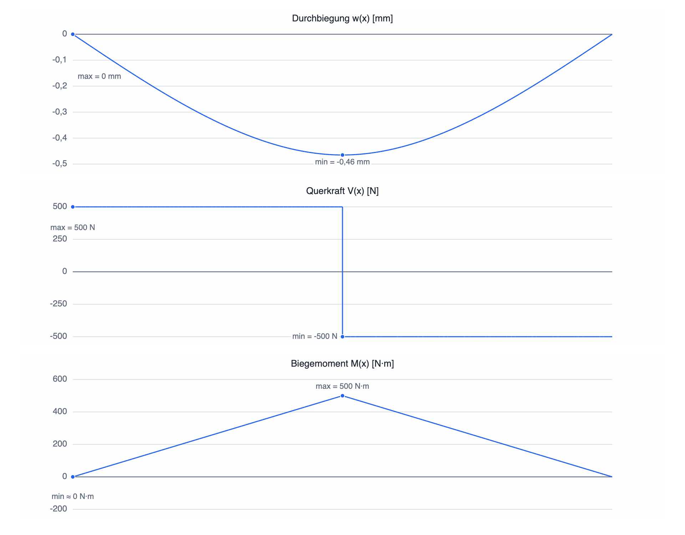

# Ergebnisdiagramme und Lagerreaktionen

Wenn das bestätigte Modell berechenbar ist, zeigt SpanDraft im Arbeitsbereich drei Ergebnisdiagramme sowie in der Projektübersicht die Lagerreaktionen und ausgewählte Kennwerte. Die Diagramme sind **Ergebnisse der Berechnung**, keine zusätzlichen Eingabefelder.

## Die drei Diagramme

| Diagramm | Was es zeigt | Typische Einheit (Maschinenbau) |
| --- | --- | --- |
| **Durchbiegung `w(x)`** | Vertikale Verschiebung der Balkenachse über die Länge | mm |
| **Querkraft `V(x)`** | Innerer Querkraftverlauf | N |
| **Biegemoment `M(x)`** | Innerer Biegemomentverlauf | N·m |

Die horizontale Richtung der Diagramme entspricht der Balkenlängskoordinate `x`. Positive und negative Werte sind getrennt zu beachten. Eine ausgeprägte positive Momentenspitze und eine negative Durchbiegung können zum **selben** Lastfall gehören – das ist kein Widerspruch.

### Durchbiegung

Das Durchbiegungsdiagramm zeigt `w(x)` mit seinem Vorzeichen. Eine nach unten gerichtete Verformung ist **negativ**. Für die konstruktive Beurteilung kann die betragsmäßig größte Durchbiegung relevant sein. Die Kennzahl **Maximale Durchbiegung** in der Projektübersicht ist deshalb ein **nichtnegativer Betrag**.

Beachten Sie den Unterschied zwischen dem Wert im Diagramm und der Kennzahl: Bei `w = −0,465 mm` am kritischen Ort steht in der Übersicht ein Betrag von ungefähr `0,465 mm` (vor Rundung).

### Querkraft

Die Querkraft kann an **Punktkräften** oder **Lagerreaktionen** sprunghaft wechseln. Unter einer konstanten Streckenlast verläuft sie **linear**. Ein Querkraftsprung ist daher normalerweise eine Aussage über eine konzentrierte Einwirkung, kein Fehler in der Zeichnung.

### Biegemoment

Das Biegemoment ist bei Bereichen ohne Streckenlast zwischen konzentrierten Einwirkungen in der Regel **linear**. Unter konstanter Streckenlast hat der Verlauf eine **quadratische** Form. Punktmomente können einen **Momentensprung** erzeugen. Große positive und große negative Werte sind jeweils relevant, weil die Biegespannung vom **Betrag** des Moments abhängt.

## Minima, Maxima und Sprungstellen

SpanDraft kennzeichnet Minima und Maxima der Kurven. Bei Punktlasten oder Punktmomenten können die Werte unmittelbar **links** und **rechts** derselben Position verschieden sein:

- Eine Punktkraft erzeugt im Querkraftdiagramm einen Sprung.
- Ein Punktmoment erzeugt im Biegemomentdiagramm einen Sprung.
- Verformung und Rotation bleiben an diesen Stellen im aktuellen durchgehenden Balkenmodell stetig.

Die Sprungstellen werden nicht durch Mittelwerte geglättet. Die Berechnung der Extremwerte erfolgt aus stückweisen analytischen Verläufen, nicht allein aus wenigen gezeichneten Stützpunkten. Die Darstellung nähert diese Verläufe grafisch an, während die ermittelten Extremwerte aus der Berechnung stammen.

## Lagerreaktionen in der Projektübersicht

Die **Reaktionen** beschreiben, wie die Lager die äußeren Lasten ausgleichen. Je nach Lagertyp gibt es Horizontalkraft `Rx`, Vertikalkraft `Ry` und/oder Lagermoment. Ein Festlager kann beispielsweise `Rx` und `Ry` übertragen, aber kein Reaktionsmoment; eine Einspannung alle drei Größen.

Bei einem einfach gelagerten Balken mit einer mittigen Punktkraft von `−1.000 N` müssen sich die vertikalen Lagerreaktionen zu `+1.000 N` addieren. Bei mittiger Last und symmetrischer Lagerung sind es jeweils `+500 N`.

Die Reaktionen werden unter Berücksichtigung der Lagerbedingungen berechnet. Bei statisch unbestimmten Systemen ergeben sie sich **nicht allein aus den Gleichgewichtsbedingungen**, sondern zusätzlich aus der Verformungsverträglichkeit und Steifigkeit.

## Maßgebende Kennwerte

In der Projektübersicht stehen zusätzlich:

- **Maximale Durchbiegung:** größter **Betrag** der berechneten Querverschiebung;
- **Maßgebendes Moment:** größter **Betrag** des Biegemoments;
- **Maximale Biegespannung:** aus maßgebendem Moment und elastischen Widerstandsmomenten ermittelter Spannungsbetrag;
- **Sicherheitsfaktor:** Verhältnis zwischen hinterlegter Streckgrenze und maximalem elastischem Biegespannungsbetrag.

Bei der Auswahl der maßgebenden Durchbiegung beziehungsweise des Moments werden die positiven und negativen Extremwerte **nach ihrem Betrag** verglichen. Die Vorzeichen bleiben im jeweiligen Diagramm erhalten. Der Sicherheitsfaktor bewertet nicht die Durchbiegung; seine Bedeutung steht auf [Spannung und Sicherheitsfaktor](spannung-sicherheit.md).

## Warum Ergebnisse manchmal fehlen

Ohne ausreichend Lager oder bei ungültigen beziehungsweise numerisch nicht lösbaren Modellen erscheinen **keine gültigen neuen Ergebnisdiagramme**. Das ist kein Nachweis, dass die Belastung harmlos ist. Prüfen Sie dann die Statusmeldung und die Hinweise unter [Häufige Probleme](../hintergrund/probleme.md).

Zum Nachvollziehen aller drei Verläufe eignet sich das [vollständige Beispiel mit mittiger Punktlast](../erste-schritte/erste-berechnung.md). Für die Vorzeichen lesen Sie [Koordinaten, Vorzeichen und Einheiten](../modell/koordinaten-einheiten.md).
