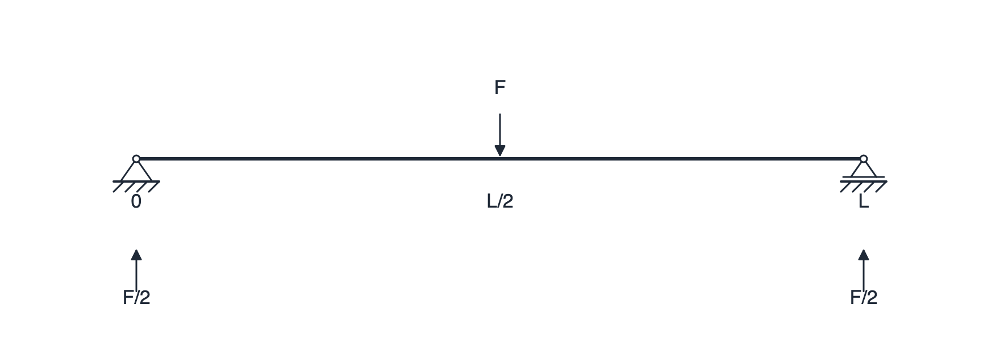

# Erste Berechnung: ein Balken mit mittiger Punktlast

Dieses Beispiel zeigt den vollständigen Weg von der Eingabe bis zur Prüfung der Ergebnisse. Wir verwenden einen einfach gelagerten Balken mit einer nach unten gerichteten Kraft in der Mitte.



## 1. Beispieldaten

| Größe | Eingabe |
| --- | --- |
| Balkenlänge `L` | 2.000 mm |
| Werkstoff | S235JR (eingebauter Werkstoffkatalog) |
| E-Modul `E` | 210 GPa |
| Streckgrenze `fy` | 235 MPa |
| Querschnitt | Rechteck: Breite `b = 40 mm`, Höhe `h = 80 mm` |
| Gewählte Biegeachse | `y-y` (Biegung um die zur Breite parallele Querschnittsachse) |
| Linkes Lager | Festlager bei `x = 0 mm` |
| Rechtes Lager | Loslager bei `x = 2.000 mm` |
| Punktkraft | `F = −1.000 N` bei `x = 1.000 mm` |

Die Zahlen beziehen sich auf das Einheitenprofil **Maschinenbau**. Ist ein anderes Profil aktiv, verwenden Sie die entsprechenden Einheiten, etwa `L = 2 m` und `F = −1 kN`.

Die Last wirkt nach unten. Weil die positive Querrichtung in SpanDraft nach oben zeigt, muss die Kraft **negativ** eingegeben werden.

## 2. Projekt anlegen

1. Wählen Sie **Datei → Neues Projekt**.
2. Stellen Sie die Balkenlänge auf **2.000 mm**.
3. Öffnen Sie die Werkstoffauswahl und wählen Sie **S235JR**. Kontrollieren Sie E-Modul und Streckgrenze.
4. Öffnen Sie die Querschnittsdefinition. Wählen Sie die Form **Rechteck** und tragen Sie `b = 40 mm` und `h = 80 mm` ein.
5. Wählen Sie die Biegeachse **y-y** und übernehmen Sie den Querschnitt.
6. Bestätigen Sie die Projektdefinition über **Projekt erstellen**.

Die Biegeachse ist entscheidend: Die Rechnung in diesem Beispiel verwendet das Flächenträgheitsmoment um `y-y`. Bei `z-z` wäre der Rechteckbalken für diese Biegeebene weniger steif. Mehr dazu steht auf [Balken, Werkstoff und Querschnitt](../modell/werkstoff-querschnitt.md).

## 3. Lager setzen

1. Wählen Sie in der Werkzeugleiste **Festlager** und platzieren Sie es links am Balken. Stellen Sie die Position exakt auf `0 mm`.
2. Wählen Sie **Loslager**, platzieren Sie es rechts und bestätigen Sie `2.000 mm`.

Diese Kombination verhindert die Verschiebung des gesamten Balkens in Längs- und Querrichtung, lässt aber die Drehungen an beiden Lagern zu. Eine Einspannung wird **nicht** verwendet.

## 4. Kraft eingeben

Wählen Sie **Punktkraft**, klicken Sie ungefähr in die Balkenmitte und tragen Sie im Bearbeitungsbereich ein:

- Position `x = 1.000 mm`
- Kraft `F = −1.000 N`

Bestätigen Sie die Eingabe. Nach dieser bestätigten Änderung berechnet SpanDraft das Modell neu.

## 5. Ergebnisse prüfen

Für diesen idealisierten Lastfall lauten die **rechnerischen Werte vor Anzeigerundung**:

| Ergebnis | Erwarteter Wert | Bedeutung |
| --- | ---: | --- |
| Vertikale Reaktion links | `+500 N` | Nach oben gerichtete Lagerkraft |
| Vertikale Reaktion rechts | `+500 N` | Nach oben gerichtete Lagerkraft |
| Maximale Durchbiegung (Betrag) | `0,46503 mm` | In der Mitte; die signed Durchbiegung ist `−0,46503 mm` |
| Maßgebendes Biegemoment (Betrag) | `500 N·m` | In der Balkenmitte; positiv/sagend |
| Maximale elastische Biegespannung | `11,71875 MPa` | Betrag der Biegespannung |
| Sicherheitsfaktor | `20,0533` | Verhältnis Streckgrenze / Biegespannung |

Die *Standardanzeige* rundet bewusst. Bei diesen Eingaben sind deshalb beispielsweise **`0,46 mm`** für die maximale Durchbiegung und **`20`** für den Sicherheitsfaktor zu erwarten. Die gerundete Anzeige darf nicht mit dem ungerundeten Rechenwert verwechselt werden.

Die Diagramme zeigen: links der Punktkraft `V = +500 N`, rechts `V = −500 N`; das Biegemoment steigt von links bis zur Mitte auf `+500 N·m` und fällt rechts auf null. Die Durchbiegung ist zwischen den Lagern negativ und in der Mitte betragsmäßig am größten.

## 6. Warum ergeben sich diese Werte?

Für einen rechteckigen Querschnitt mit Biegung um `y-y` gilt:

```text
A  = b · h                         = 3.200 mm²
Iy = b · h³ / 12                   = 1.706.667 mm⁴
Wy = b · h² / 6                    = 42.667 mm³

RA = RB = P / 2                    = 500 N
Mmax = P · L / 4                   = 500 N·m
|w|max = P · L³ / (48 · E · Iy)     ≈ 0,46503 mm
σb,max = Mmax / Wy                 = 11,71875 MPa
S = fy / σb,max                    ≈ 20,0533
```

Hier ist `P = 1.000 N` der **positive Betrag** der nach unten wirkenden Kraft; in der SpanDraft-Eingabe steht dafür `F = −1.000 N`. Die gerundeten `Iy`-/`Wy`-Tabellenwerte in dieser Darstellung wurden nicht für die Berechnung der Ergebniszahlen verwendet.

Die Gleichungen gelten für genau diesen symmetrischen, einfach gelagerten Lastfall. Sie sind keine allgemeine Berechnungsformel für beliebige Lagerungen oder Lasten.

## 7. Projekt speichern

Wählen Sie **Datei → Speichern**, geben Sie einen Dateinamen wie `Balken_Mittellast.spandraft` an und speichern Sie das Projekt. Öffnen Sie es testweise erneut über **Datei → Öffnen…**. SpanDraft lädt die Eingaben und berechnet die Ergebnisse erneut.

## Was dieses Beispiel bewusst nicht nachweist

Ob der reale Balken als Bauteil geeignet ist, hängt zusätzlich unter anderem von der tatsächlichen Einspannung/Lagerausführung, Knicken oder Beulen, Verbindungen, anderen Spannungsarten und den zulässigen Durchbiegungen ab. Der hier ausgegebene Sicherheitsfaktor bewertet **nur die elastische Biegespannung gegenüber der hinterlegten Streckgrenze**. Mehr dazu: [Spannung und Sicherheitsfaktor](../ergebnisse/spannung-sicherheit.md) und [Berechnungsmodell und Grenzen](../hintergrund/modellannahmen.md).
