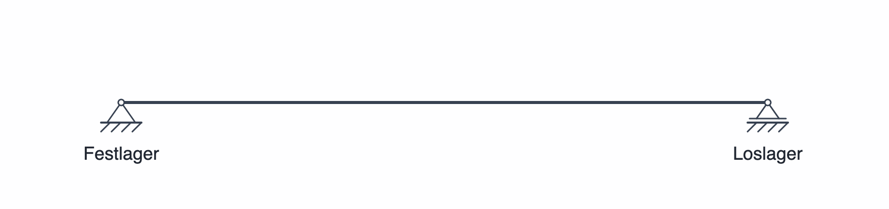
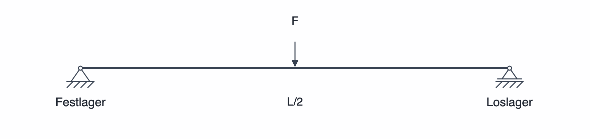
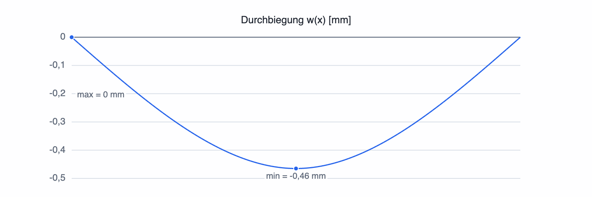
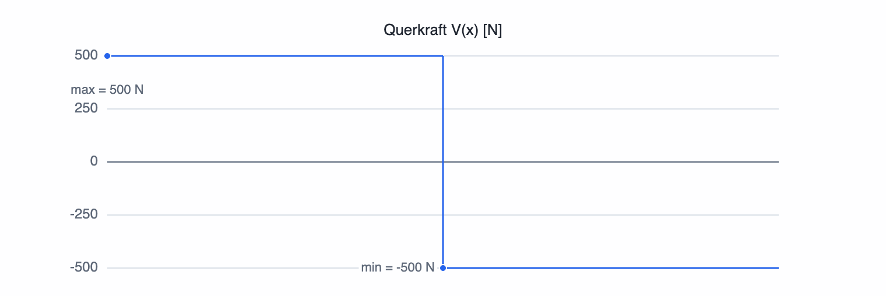
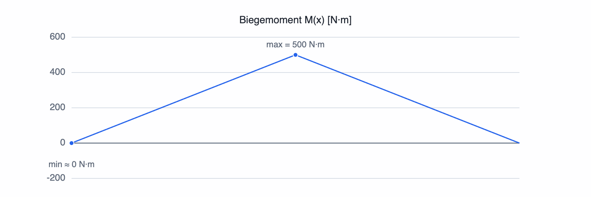

# Erste Berechnung: ein Balken mit mittiger Punktlast

An einem einfach gelagerten Balken mit mittiger Punktkraft wird einmal der vollständige SpanDraft-Ablauf gezeigt.

## 1. Projekt definieren

Ein neues Balkenprojekt benötigt zunächst seine Länge, einen Werkstoff und einen Querschnitt. Für das Beispiel sind das:

- Balkenlänge `L = 2 m`;
- Werkstoff **S235JR**;
- Rechteckquerschnitt **40 × 80 mm** mit Breite `b = 40 mm` und Höhe `h = 80 mm`;
- Biegeachse **y-y**.

Die Biegeachse gehört zum Modell: Sie legt fest, welche Querschnittskennwerte für Biegesteifigkeit und Biegespannung verwendet werden. Beim Rechteck ist `y-y` die zur Breite parallele Achse.

## 2. Lagerung festlegen

Im nächsten Schritt wird festgelegt, wie der Balken gehalten wird. Im Beispiel liegt ein **Festlager am linken Ende** und ein **Loslager am rechten Ende**. Diese Kombination verhindert die starre Bewegung des Balkens, lässt aber die Drehung an beiden Lagern zu.

## 3. Belastung hinzufügen

Im Beispiel wirkt eine Punktkraft von **1 kN** in der Balkenmitte nach unten. SpanDraft verwendet die positive `w`-Richtung nach oben. Deshalb wird die Kraft als **`F = −1 kN`** bei `x = L/2 = 1 m` eingegeben.

## 4. Automatisch berechnen und Ergebnisse beurteilen

Sobald Lagerung und Belastung ein berechenbares Modell ergeben, aktualisiert SpanDraft die Ergebnisse nach bestätigten Änderungen automatisch.

Die Diagramme zeigen die Durchbiegung `w(x)`, die Querkraft `V(x)` und das Biegemoment `M(x)`. Außerdem stehen Lagerreaktionen, maximale Durchbiegung, maßgebendes Moment, maximale elastische Biegespannung und Sicherheitsfaktor zur Verfügung.

Am Beispiel lässt sich unmittelbar erkennen:

- Die Durchbiegung ist in der Mitte betragsmäßig am größten.
- Die Querkraft springt an der Punktkraft.
- Das größte Biegemoment liegt in der Mitte.

## Was SpanDraft daraus berechnet

SpanDraft bildet aus Balkengeometrie, Werkstoff, Lagerung und Belastung das Berechnungsmodell und ermittelt daraus Lagerreaktionen, Verformung und Schnittgrößen. Aus Biegemoment und Querschnittskennwerten wird anschließend die elastische Biegespannung bestimmt; der Sicherheitsfaktor beschreibt das Verhältnis der hinterlegten Streckgrenze zu dieser Spannung.

Details erläutern [Ergebnisdiagramme und Lagerreaktionen](../ergebnisse/diagramme-reaktionen.md), [Spannung und Sicherheitsfaktor](../ergebnisse/spannung-sicherheit.md) sowie [Berechnungsmodell und Grenzen](../hintergrund/modellannahmen.md).

## 5. Projekt speichern

Das fertige Modell kann als `.spandraft`-Projekt gespeichert und später wieder geöffnet werden. Die Eingaben werden gespeichert; die Ergebnisse werden beim Öffnen erneut berechnet.
