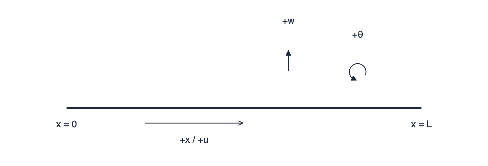

# Koordinaten, Vorzeichen und Einheiten

Bei Balkenberechnungen entstehen viele Missverständnisse durch ein vertauschtes Vorzeichen oder eine falsch interpretierte Achse. SpanDraft verwendet feste Konventionen. Sie gelten unabhängig davon, ob die Benutzeroberfläche deutsche oder englische Texte zeigt.

## Balkenkoordinaten und Verschiebungen



- `x` verläuft entlang des Balkens **von links nach rechts**. Das linke Balkenende ist `x = 0`, das rechte `x = L`.
- `u` ist die **axiale Verschiebung**: positiv nach rechts.
- `w` ist die **Querverschiebung** in der modellierten Biegeebene: positiv nach oben.
- `θ` ist die **Rotation** des Balkenquerschnitts: positiv gegen den Uhrzeigersinn. Im Euler-Bernoulli-Modell gilt `θ = dw/dx`.

Eine nach unten ausweichende Balkenmitte hat demnach `w < 0`. In der Projektübersicht wird die **maximale Durchbiegung als Betrag** angezeigt; im Durchbiegungsdiagramm bleibt das Vorzeichen dagegen erhalten.

Alle Positionen sind echte Abstände ab dem linken Ende. Ein `x`-Wert ist keine Bildschirmkoordinate und hängt nicht davon ab, wie stark die Skizze optisch entzerrt dargestellt wird.

## Vorzeichen der Einwirkungen und Reaktionen

| Größe | Positiv | Negativ |
| --- | --- | --- |
| Punktkraft `F`, Streckenlast `q` | nach oben | nach unten |
| Aufgebrachtes Punktmoment | gegen den Uhrzeigersinn | im Uhrzeigersinn |
| Horizontale Lagerreaktion `Rx` | nach rechts | nach links |
| Vertikale Lagerreaktion `Ry` | nach oben | nach unten |
| Lagermoment | gegen den Uhrzeigersinn | im Uhrzeigersinn |

Ein Lastwert und seine Reaktion müssen nicht dasselbe Vorzeichen haben. Eine nach unten gerichtete Punktkraft kann durch positive, also nach oben gerichtete Lagerreaktionen ausgeglichen werden.

## Vorzeichen der inneren Schnittgrößen

Die inneren Größen beschreiben, was der Balken **im Querschnitt** überträgt. Ihre Konvention ist nicht einfach gleichbedeutend mit dem Vorzeichen einer von außen aufgebrachten Last.

| Schnittgröße | Positives Vorzeichen in SpanDraft |
| --- | --- |
| Normalkraft `N` | **Zug** |
| Querkraft `V` | definiert durch die Steigung des Biegemoments: `V = dM/dx` |
| Biegemoment `M` | **sagendes Biegemoment** – bei einem üblichen einfach gelagerten Balken mit nach unten gerichteter Last positives Moment |

Ein positives sagendes Biegemoment wird in der üblichen Darstellung als nach unten durchgebogener Verlauf eines einfach gelagerten Balkens verstanden. Wichtig: **Die Vorzeichen von `w` und `M` sind dabei nicht gleich.** Die Durchbiegung ist im Beispiel negativ, das Biegemoment positiv.

Für einen einfach gelagerten Balken mit einer mittigen Last `−P` (`P > 0`) gilt:

```text
Links der Last:     V = +P/2
Rechts der Last:    V = −P/2
Unter der Last:     M = +P·L/4
Balkenmitte:        w < 0
```

Der Querkraftverlauf springt an einer Punktkraft oder vertikalen Lagerreaktion. Ein Punktmoment beziehungsweise ein Lagermoment kann einen Sprung des inneren Momentenverlaufs verursachen. Es gelten die Regeln:

```text
V(x rechts) − V(x links) = Summe der Punktkräfte und
                          vertikalen Reaktionen an x

M(x rechts) − M(x links) = −(Summe der aufgebrachten Punktmomente
                            und Reaktionsmomente an x)
```

Das Vorzeichen der Momente in der zweiten Beziehung verdient besondere Aufmerksamkeit. Mehr zum Ablesen der Sprünge: [Ergebnisdiagramme und Lagerreaktionen](../ergebnisse/diagramme-reaktionen.md).

## Querschnittskoordinaten sind etwas anderes

In der Querschnittsdefinition heißen die lokalen geometrischen Richtungen `y` (horizontal) und `z` (vertikal). Die Biegeachsen heißen entsprechend `y-y` und `z-z`, bei Winkelprofilen `u-u` und `v-v`.

Die Balkenkoordinate `x` und die Querverschiebung `w` beschreiben dagegen das **zweidimensionale Balkenmodell**. Die ausgewählte Biegeachse bestimmt die verwendeten Querschnittskennwerte. Aus der Auswahl entsteht **keine räumliche Drehung des gesamten Balkens** und keine 3D-Kraftzerlegung.

Die bei asymmetrischen Profilen möglichen Zeichen `W+` und `W−` bedeuten positive und negative **geometrische Querschnittsseiten**, nicht positive oder negative Spannung. Weitere Details: [Balken, Werkstoff und Querschnitt](werkstoff-querschnitt.md).

## Einheiten

Unter **Bearbeiten → Einstellungen… → Einheiten** können Sie die Anzeigeeinheiten ändern. SpanDraft bietet die Profile **Maschinenbau**, **Bauwesen** und **US-amerikanisch**. Individuell geänderte Kombinationen werden als **Benutzerdefiniert** geführt.

| Größe | Maschinenbau (Standard) | Bauwesen | US-amerikanisch |
| --- | --- | --- | --- |
| Balkenlänge, Position | mm | m | ft |
| Querschnittsmaße | mm | mm | in |
| Verschiebung | mm | mm | in |
| Fläche `A` | mm² | cm² | in² |
| Flächenträgheitsmoment `I` | mm⁴ | cm⁴ | in⁴ |
| Widerstandsmoment `W` | mm³ | cm³ | in³ |
| Kraft, Querkraft, Lagerreaktion | N | kN | kip |
| Moment | N·m | kN·m | kip·ft |
| Streckenlast | N/m | kN/m | kip/ft |
| Spannung | MPa | MPa | ksi |
| Rotation | rad | rad | rad |

**Einheiten beeinflussen die Rechnung nicht.** SpanDraft rechnet intern mit kanonischen SI-Werten. Ein Wechsel der Einheit verändert deshalb weder das gespeicherte mechanische Modell noch die physikalischen Ergebnisse. Falls gerade eine betroffene Zahl bearbeitet wird, kann SpanDraft zunächst verlangen, diese Eingabe zu bestätigen oder zu verwerfen, statt ihren Text stillschweigend neu zu interpretieren.

### Standard oder Detailliert?

Unter **Einstellungen → Numerische Ergebnisdarstellung** wählen Sie:

- **Standard:** bewusst verdichtete Ergebnisanzeige; bei ausgewählten Größen wird die angezeigte Auflösung auch an die Größenordnung des Modells angepasst.
- **Detailliert:** Darstellung mit bis zu **drei signifikanten Stellen**, ohne die zusätzliche modellabhängige Vergröberung.

Beide Modi rechnen **identisch**. Unterschiede entstehen erst beim Anzeigen der Zahlen. Die Kurven und ihre Extremwertpositionen beruhen weiterhin auf den ungerundeten Ergebnissen. Für sehr kleine, aber nicht exakt null große Werte kann `≈ 0` erscheinen; ein echtes `0` bezeichnet dagegen den exakt null gesetzten Wert.

Eine Anzeige von `1` als Sicherheitsfaktor ist keine gesicherte Gleichheit mit der Streckgrenze: Der tatsächliche Wert kann davor oder dahinter liegen. Bei fachlichen Grenzentscheidungen ist die Rundung kein Ersatz für die erforderliche Prüfung.
