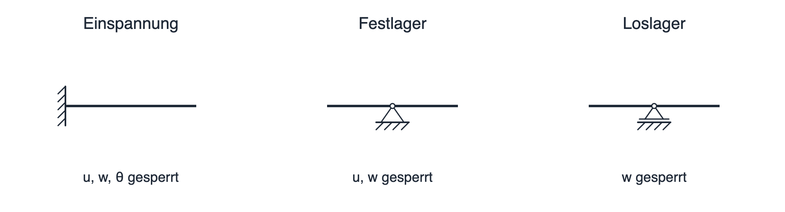

# Lager und Randbedingungen

Lager legen fest, welche Bewegungen der Balken an einer Position **nicht** ausführen darf. Damit beschreiben sie im Rechenmodell die Verbindung des Balkens mit seiner Umgebung. Eine korrekte Lagerung ist für sinnvolle Ergebnisse wichtiger als die Bezeichnung eines Lagers allein.

## Die drei Lagerarten

| Lager in SpanDraft | Verhindert | Lässt zu | Mögliche Reaktionen |
| --- | --- | --- | --- |
| **Einspannung** | Längsverschiebung `u`, Querverschiebung `w`, Rotation `θ` | keine dieser drei Bewegungen | Horizontalkraft, Vertikalkraft und Einspannmoment |
| **Festlager** | `u` und `w` | Rotation `θ` | Horizontal- und Vertikalkraft |
| **Loslager** | `w` | Längsverschiebung `u` und Rotation `θ` | Vertikalkraft |

Die Bewegungen gelten für die **modellierte zweidimensionale Biegeebene**. Ein Loslager sperrt in SpanDraft immer die vertikale Verschiebung `w`, nicht eine beliebig einstellbare Lagerrichtung. Alle gesperrten Bewegungen werden als **null** angesetzt; nachgiebige Federn oder vorgegebene Lagerverschiebungen werden nicht modelliert.

### Typische Kombinationen

- **Ein Kragarm:** eine Einspannung, etwa am linken Ende. Das genügt, um sämtliche Starrkörperbewegungen zu sperren.
- **Einfach gelagerter Balken:** ein Festlager und ein Loslager an zwei unterschiedlichen Positionen. Die Enden dürfen sich drehen; ein Lager verhindert zusätzlich die Längsverschiebung.
- **Durchlaufträger:** mehrere Lager an verschiedenen Positionen sind möglich. Der Balken bleibt an diesen Stellen **durchgehend**; ein gewöhnliches Fest- oder Loslager erzeugt kein inneres Gelenk.

Ein Festlager allein reicht dagegen nicht: Es verhindert die Bewegung am Lagerpunkt, aber ein ungesperrter Balken könnte sich weiterhin um diesen Punkt drehen. Zwei Loslager verhindern zwar vertikale Verschiebungen an zwei Positionen, lassen aber die **gesamte axiale Verschiebung** frei. SpanDraft verlangt auch ohne äußere Längslast mindestens eine axiale Festhaltung.

## Lager platzieren und ändern

1. Wählen Sie **Einspannung**, **Festlager** oder **Loslager** in der Werkzeugleiste.
2. Klicken Sie an die gewünschte Position. Beim Bewegen des Mauszeigers hilft die Positionsvorschau.
3. Stellen Sie im Bearbeitungsbereich die exakte Position `x` und bei Bedarf den Lagertyp ein.
4. Bestätigen Sie die Eingabe.

Ein vorhandenes Lager lässt sich über die Skizze oder seinen Namen in der Projektübersicht öffnen, verschieben, umbenennen oder löschen. An einer Position lässt die aktuelle Projektbearbeitung nur **ein Lager** zu. Eine Änderung der Balkenlänge darf kein Lager außerhalb des Balkens zurücklassen.

Lager müssen nicht an den Balkenenden liegen; ein Balken kann links oder rechts über ein Lager hinausragen. Überhänge werden mitberechnet, wenn das Gesamtsystem ausreichend abgestützt ist.

## Lagerreaktionen verstehen

Die Lagerreaktion ist die Kraft oder das Moment, mit der beziehungsweise dem die idealisierte Umgebung die verhinderte Bewegung erzwingt. Bei einer nach unten belasteten, einfach gelagerten Konstruktion sind die vertikalen Reaktionen üblicherweise positiv, also nach oben gerichtet.

Die Projektübersicht zeigt die berechneten Komponenten, wo sie als Reaktion vorgesehen sind. Bei einer **freien** Bewegungskomponente gibt es keine entsprechende Lagerreaktion; das ist etwas anderes als eine berechnete Reaktion mit dem Zahlenwert null. Ein Einspannmoment hat ein eigenes Vorzeichen: positiv bedeutet gegen den Uhrzeigersinn.

Für den [Balken mit mittiger Punktlast](../erste-schritte/erste-berechnung.md) ergeben sich links und rechts jeweils `+500 N` vertikale Lagerkraft. Die Summe von `+500 N + 500 N − 1.000 N` ist null.

## Modellannahme beachten

Ein reales Lager hat Reibung, Spiel, elastische Nachgiebigkeit oder eine andere tatsächliche Bewegungsfreiheit. SpanDraft berücksichtigt diese Effekte nicht automatisch. Wählen Sie die Lagerart nach den **wirklichen Bewegungsbeschränkungen**, nicht bloß nach einer Zeichnung oder einem Bauteilnamen.

Wenn das Modell keine Ergebnisse liefert, prüfen Sie insbesondere die [ausreichende Lagerung](../hintergrund/probleme.md). Vorzeichen und Komponenten werden auf [Koordinaten, Vorzeichen und Einheiten](koordinaten-einheiten.md) erklärt.
