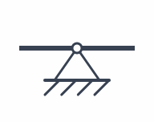
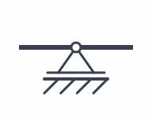

# Lager und Randbedingungen

Lager sperren die Längsverschiebung `u`, Querverschiebung `w` oder Rotation `θ` an einer Balkenposition. Die Position `x` ist ein exakter Modellwert und kann auch innerhalb des Balkens liegen. Je Position ist ein Lager möglich.

  <table>
    <thead>
      <tr><th scope="col">Lager</th><th scope="col">Symbol</th><th scope="col">Gesperrte Bewegungen</th><th scope="col">Mögliche Reaktionen</th></tr>
    </thead>
    <tbody>
      <tr><th scope="row">Einspannung</th><td></td><td><code>u</code>, <code>w</code>, <code>θ</code></td><td><code>Rx</code>, <code>Ry</code>, <code>M</code></td></tr>
      <tr><th scope="row">Festlager</th><td></td><td><code>u</code>, <code>w</code></td><td><code>Rx</code>, <code>Ry</code></td></tr>
      <tr><th scope="row">Loslager</th><td></td><td><code>w</code></td><td><code>Ry</code></td></tr>
    </tbody>
  </table>

Die Bewegungen `u`, `w` und `θ` sind auf [Koordinatensystem und Einheiten](koordinaten-einheiten.md) erklärt.

## Ausreichend lagern

Eine Einspannung kann den Balken allein ausreichend halten. Typisch ist auch ein Festlager mit einem Loslager an einer anderen Position; ein Festlager allein lässt die Drehung um seinen Lagerpunkt frei. Mehrere Lager sind möglich, ohne dass dadurch innere Gelenke entstehen. Zwei reine Loslager lassen die axiale Starrkörperbewegung frei – dann kann SpanDraft auch ohne äußere Längslast nicht rechnen.

Die Lager sind idealisiert: Gesperrte Bewegungen werden als null angesetzt; ein Loslager sperrt immer die vertikale Verschiebung `w`. Reibung, Spiel, Nachgiebigkeit und vorgegebene Lagerverschiebungen sind nicht enthalten. Wählen Sie die Lagerart nach den tatsächlichen Bewegungsbeschränkungen; Details stehen unter [Was SpanDraft berechnet – und was nicht](../hintergrund/modellannahmen.md).

Weiter: [Kräfte, Momente und Streckenlasten](lasten.md).
