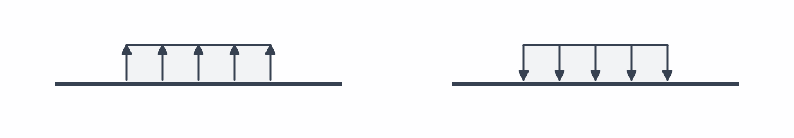

# Kräfte, Momente und Streckenlasten

Lasten beschreiben die vorgegebenen Einwirkungen in der zweidimensionalen Biegeebene.

## Punktkraft

Eine Punktkraft `F` wirkt an einer Position `x`, auch an einem Balkenende. Das Vorzeichen gibt die Richtung an.

<figure class="spandraft-load-signs">
  
<code>F &gt; 0</code> · nach oben<code>F &lt; 0</code> · nach unten

  
</figure>

## Punktmoment

Ein Punktmoment `M` wirkt an einer Position `x`, ohne dort eine zusätzliche resultierende Querkraft aufzubringen.

<figure class="spandraft-load-signs">
  
<code>M &gt; 0</code> · gegen den Uhrzeigersinn<code>M &lt; 0</code> · im Uhrzeigersinn

  
</figure>

Mehrere Punktkräfte und Punktmomente dürfen an derselben Position liegen.

## Konstante Streckenlast

Eine konstante Streckenlast `q` wirkt gleichmäßig von `xStart` bis `xEnd`. Sie ist eine **Kraft pro Länge**; Start und Ende definieren den belasteten Bereich mit `0 ≤ xStart < xEnd ≤ L`.

<figure class="spandraft-load-signs">
  
<code>q &gt; 0</code> · nach oben<code>q &lt; 0</code> · nach unten

  
</figure>

Mehrere Streckenlasten dürfen sich überlagern; ihre Intensitäten werden vorzeichenbehaftet addiert. Dreieckige oder veränderliche Streckenlasten gibt es aktuell nicht als eigenen Lasttyp.

  
Resultierende einer konstanten Streckenlast

  
Die Resultierende beträgt <code>Fq = q · (xEnd − xStart)</code> und greift in der Mitte des belasteten Bereichs bei <code>xq = (xStart + xEnd) / 2</code> an. Diese Ersatzkraft beschreibt das globale Gleichgewicht. Für Verformung und Schnittgrößen behandelt SpanDraft die Streckenlast weiterhin als verteilte Last.

## Grenzen des Lastmodells

Die hinterlegte Dichte erzeugt kein automatisches Eigengewicht. Axiale oder schräge Kräfte sowie Torsionsmomente gehören derzeit nicht zum unterstützten Lastmodell. Mehr dazu: [Was SpanDraft berechnet – und was nicht](../hintergrund/modellannahmen.md).

Weiter: [Ergebnisdiagramme und Lagerreaktionen](../ergebnisse/diagramme-reaktionen.md).
