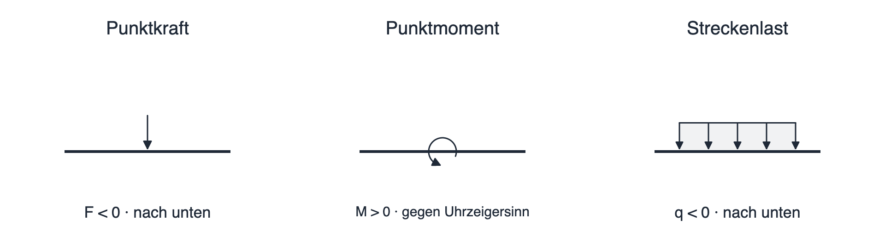

# Kräfte, Momente und Streckenlasten

Lasten beschreiben die Einwirkungen, die Sie dem Balken im Modell vorgeben. SpanDraft unterstützt **Punktkräfte**, **Punktmomente** und **konstante Streckenlasten**. Die Lasten wirken in der ausgewählten zweidimensionalen Biegeebene.



## Punktkraft

Eine Punktkraft `F` wirkt an einer einzelnen Position `x`. Sie wird im Modell an dieser Position konzentriert angesetzt, unabhängig davon, über welche reale Kontaktfläche sie tatsächlich eingeleitet wird.

- `F > 0`: Kraft nach **oben**.
- `F < 0`: Kraft nach **unten**.
- `F = 0`: keine Kraftwirkung.

Beispiel: `F = −1.000 N` bei `x = 800 mm` bedeutet eine nach unten gerichtete Kraft von 1 kN, die 800 mm vom linken Balkenende angreift. Ein Minuszeichen bezeichnet die **Richtung**, nicht eine ungültige Eingabe.

## Punktmoment

Ein Punktmoment `M` wirkt an einer bestimmten Balkenposition, ohne dort zusätzlich eine resultierende Querkraft aufzubringen.

- `M > 0`: aufgebrachtes Moment **gegen den Uhrzeigersinn**.
- `M < 0`: aufgebrachtes Moment **im Uhrzeigersinn**.

Die Vorzeichen eines **aufgebrachten** Moments und des **inneren Biegemomentverlaufs** sind getrennt zu betrachten. Ein positives aufgebrachtes Punktmoment erzeugt am Ort der Einleitung im inneren Momentenverlauf einen Sprung mit **negativem** Vorzeichen. Die vollständige Konvention wird auf [Koordinaten, Vorzeichen und Einheiten](koordinaten-einheiten.md) erläutert.

## Konstante Streckenlast

Eine Streckenlast `q` wirkt gleichmäßig über einen gewählten Bereich von `xStart` bis `xEnd`:

- `q > 0`: entlang dieses Bereichs nach oben.
- `q < 0`: entlang dieses Bereichs nach unten.
- Der Bereich muss **innerhalb des Balkens** liegen und eine **positive Länge** besitzen: `0 ≤ xStart < xEnd ≤ L`.

Die Eingabe `q` ist eine **Kraft pro Länge**, keine Gesamtkraft. Beispiel: Eine gleichmäßige Streckenlast von `q = −500 N/m` über `2 m` entspricht einer nach unten wirkenden resultierenden Kraft von `−1.000 N`.

```text
Resultierende einer konstanten Streckenlast:
Fq = q · (xEnd − xStart)

Angriffspunkt der Resultierenden:
xq = (xStart + xEnd) / 2
```

Diese Ersatzkraft erklärt das **globale Gleichgewicht** der gleichmäßigen Last. Für Durchbiegung und innere Schnittgrößen behandelt SpanDraft die Streckenlast jedoch als verteilte Einwirkung; sie wird im Rechenkern nicht einfach durch eine einzige Punktkraft ersetzt.

Mehrere Streckenlasten dürfen sich überlagern. Wo ihre Bereiche überlappen, werden die Intensitäten **vorzeichenbehaftet addiert**. Wechselnde oder dreieckförmige Lastverläufe sind als eigener Lasttyp in dieser Version nicht vorhanden.

## Lasten setzen und bearbeiten

1. Aktivieren Sie **Punktkraft**, **Moment** oder **Streckenlast** in der Werkzeugleiste.
2. Platzieren Sie bei einer Punktlast den Angriffspunkt durch einen Klick. Bei einer Streckenlast wählen Sie nacheinander **beide Bereichsgrenzen**.
3. Geben Sie anschließend die exakten Werte für Position(en) und Last ein.
4. Bestätigen Sie die Änderung. Erst dann wird das Modell neu berechnet.

Vorhandene Lasten können über die Skizze oder ihre Namen in der Projektübersicht bearbeitet und gelöscht werden. Positionen beziehungsweise Streckenlastgrenzen lassen sich auch interaktiv verschieben und anschließend numerisch kontrollieren.

Die Balkenenden sind gültige Positionen für Punktlasten. Eine Streckenlast darf am Balkenende beginnen oder enden, ihre Anfangs- und Endposition dürfen jedoch nicht identisch sein. Einzelne Lasten an der gleichen Position und überlappende Streckenlasten sind grundsätzlich möglich.

## Was nicht automatisch als Last entsteht

Die im Werkstoff gespeicherte Dichte erzeugt noch **keine Eigengewichtslast**. Wenn Sie das Eigengewicht in einer passenden Biegeebene betrachten möchten, müssen Sie die entsprechende konstante Streckenlast selbst bestimmen und eingeben. Für einen horizontalen Balken mit vertikal nach unten wirkender Schwerkraft wäre beispielsweise:

```text
qG = −ρ · A · g
ρ in kg/m³, A in m², g ≈ 9,81 m/s²  →  qG in N/m
```

Diese Gleichung setzt voraus, dass die Gewichtskraft in der betrachteten Biegeebene **quer zur Balkenachse** wirkt. Bei anderer Einbaulage, zusätzlichen Gewichtsanteilen oder einer axialen Gewichtskomponente ist diese vereinfachte Eingabe nicht ohne Weiteres geeignet.

Äußere **axiale Punktkräfte**, schräge Kräfte mit einem Winkel und Torsionsmomente sind im aktuellen Lastumfang nicht vorgesehen. Eine schräg wirkende reale Kraft kann nicht einfach als beliebige 3D-Einwirkung eingegeben werden. Prüfen Sie dafür [Berechnungsmodell und Grenzen](../hintergrund/modellannahmen.md).

Weiter: [Ergebnisdiagramme und Lagerreaktionen](../ergebnisse/diagramme-reaktionen.md).
