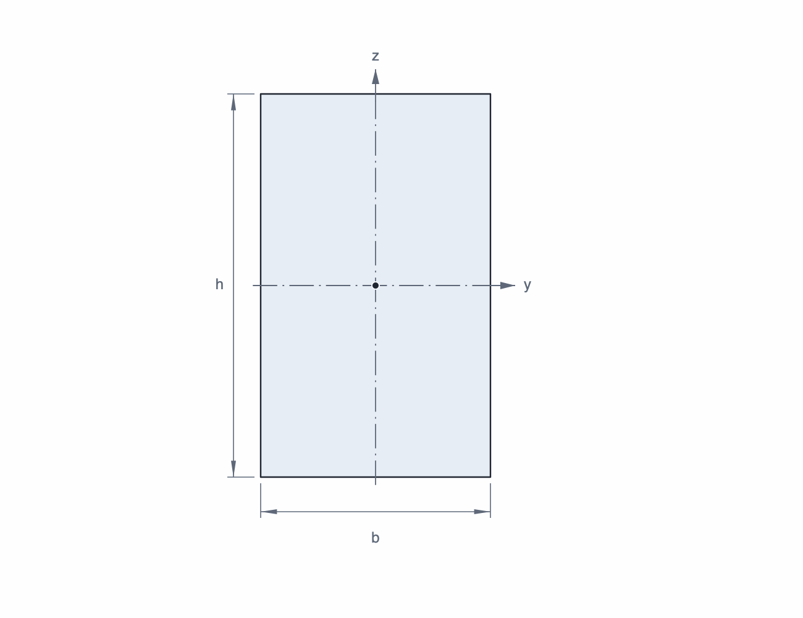

# Balken, Werkstoff und Querschnitt

Ein SpanDraft-Balken wird durch seine Länge `L`, den Werkstoff, den Querschnitt und die verwendete Biegeachse definiert.

## Balkenlänge

Die Länge reicht von `x = 0` links bis `x = L` rechts. Lager und Lasten können an den Enden oder innerhalb des Balkens liegen; Überhänge sind möglich. Beim Verkürzen müssen alle Lager und Lasten innerhalb der neuen Länge bleiben.

## Werkstoff

| Kennwert | Bedeutung in SpanDraft |
| --- | --- |
| `E` – Elastizitätsmodul | Bestimmt die Steifigkeit und damit Verformung und Rotation |
| Festigkeitskennwert: Streckgrenze `Re` oder 0,2-%-Dehngrenze `Rp0,2` | Wird für den Sicherheitsfaktor verwendet |

Dichte `ρ` und Poissonzahl `ν` können gespeichert werden, gehen aber nicht direkt in die aktuelle Balkenberechnung ein. Insbesondere erzeugt die Dichte kein automatisches Eigengewicht. Werkstoffnummer, Normbezeichnungen und Kategorie dienen der Identifikation. Katalogwerte sind technische Referenzwerte und ersetzen keine passende Norm, Herstellerangabe oder Materialbescheinigung.

Der Werkstoff besitzt genau einen Festigkeitskennwert. Bei eigenen Definitionen
wählen Sie dessen Typ ausdrücklich und geben einen zugehörigen Zahlenwert ein.
Die Kategorie legt den Typ nicht fest. Bei älteren Daten kann der Typ noch fehlen;
vor dem Bearbeiten, regulären Projektspeichern oder Erstellen eines Berichts muss
er im Werkstoffeditor festgelegt werden.

### Werkstoffbibliothek

Die gemeinsame Werkstofftabelle enthält den Projektwerkstoff und verfügbare
Vorlagen. Der Projektwerkstoff trägt ein Häkchen und den Zusatz **(aktuell im
Projekt)**. Wenn er zu Suche und Filter passt, steht er an erster Stelle.
Unter **Quelle** können Sie ausschließlich den Projektwerkstoff, eingebaute
Werkstoffe oder **Meine Werkstoffe** anzeigen. Kategorien berücksichtigen alle
drei Quellen. Ein Schloss kennzeichnet ausschließlich eingebaute,
schreibgeschützte Werkstoffe. **Kopie erstellen…** legt
eine bearbeitbare Variante in **Meine Werkstoffe** an. Auch **Neuer Werkstoff**
speichert nach Bestätigung einen eigenen Bibliothekseintrag.

**Anpassen…** öffnet einen kleinen Dialog. Dessen **OK** bestätigt die Bearbeitung:
bei eigenen Werkstoffen wird der Bibliothekseintrag direkt gespeichert, beim
Projektwerkstoff zunächst nur der Arbeitsstand der geöffneten Auswahl.
**Übernehmen** überträgt den markierten Werkstoff in die Projektübersicht; dort
bestätigen Sie die Projektänderungen gemeinsam. **Abbrechen** in der Auswahl
verwirft den Projekt-Arbeitsstand, erhält aber bereits bestätigte
Bibliotheksänderungen.

Das Projekt speichert sämtliche Werte einschließlich Kategorie, Werkstoffnummer
und anderer Normen als unabhängigen Snapshot. Späteres Ändern oder Löschen eines
Bibliothekseintrags verändert bestehende Projekte nicht. **In Bibliothek
speichern…** ist beim Projektwerkstoff verfügbar, solange noch kein vollständig
identischer Werkstoff existiert. Bei gleichem eigenen Namen mit anderen Daten
können Sie den vorhandenen Eintrag nach zusätzlicher Bestätigung ersetzen, die
Bezeichnung anpassen oder abbrechen.

## Querschnitt

Bei einem **parametrischen Querschnitt** geben Sie geometrische Maße vor; SpanDraft berechnet daraus `A`, `I`, `W+` und `W−`. Die Maße beschreiben eine idealisierte Form, nicht automatisch ein genormtes Handelsprofil.

  
Unterstützte parametrische Formen

  <ul>
    <li>Rechteck: Breite und Höhe</li>
    <li>Rechteckrohr: Außenbreite, Außenhöhe, Wanddicke, optional Außenradius</li>
    <li>Rundmaterial: Durchmesser</li>
    <li>Rundrohr: Außendurchmesser und Wanddicke</li>
    <li>I-/H-Profil: Höhe, Breite, Steg- und Flanschdicke, innerer Radius</li>
    <li>U-Profil: Höhe, Breite, Steg- und Flanschdicke, innerer Radius</li>
    <li>T-Profil: Höhe, Breite, Steg- und Flanschdicke, innerer Radius</li>
    <li>Winkelprofil: Breite, Höhe, Schenkeldicke, innerer Radius</li>
  </ul>
  
Bei Rechteckrohren folgt der Innenradius aus Außenradius und Wanddicke. Bei I-, U-, T- und Winkelprofilen bleiben die Außenkanten scharf. Ein Radius von null bedeutet eine scharfe Ecke.

Bei **manuellen Kennwerten** geben Sie vorhandene Tabellen- oder Herstellerwerte für `A`, `I` und `W` direkt vor: für eine Achse oder ein Achsenpaar `y-y/z-z` beziehungsweise `u-u/v-v`. Dabei gilt `W+ = W− = W`; unterschiedliche Widerstandsmomente unsymmetrischer Profile lassen sich so nicht vollständig abbilden. Manuelle Kennwerte enthalten keine geometrische Kontur und keinen abgeleiteten Schwerpunkt.

| Größe | Bedeutung |
| --- | --- |
| `A` | Querschnittsfläche, z. B. in mm² |
| `I` | Flächenträgheitsmoment in z. B. mm⁴; bestimmt zusammen mit `E` die Biegesteifigkeit |
| `W+`, `W−` | Werden für die elastische Biegespannung verwendet, z. B. in mm³ |

`W+` und `W−` beziehen sich auf geometrische Profilseiten, nicht auf Zug oder Druck. Eigene Querschnitte können in der Bibliothek gespeichert und wiederverwendet werden. Im Projekt bleibt eine unabhängige Kopie gespeichert.

## Biegeachse

Standardprofile verwenden `y-y` oder `z-z`, Winkelprofile die Hauptachsen `u-u` oder `v-v`. Die gewählte Achse bestimmt, welches `I` und welche Widerstandsmomente in die zweidimensionale Berechnung eingehen. SpanDraft berechnet nicht gleichzeitig um zwei Achsen.

Weiter: [Lager und Randbedingungen](lager.md).
